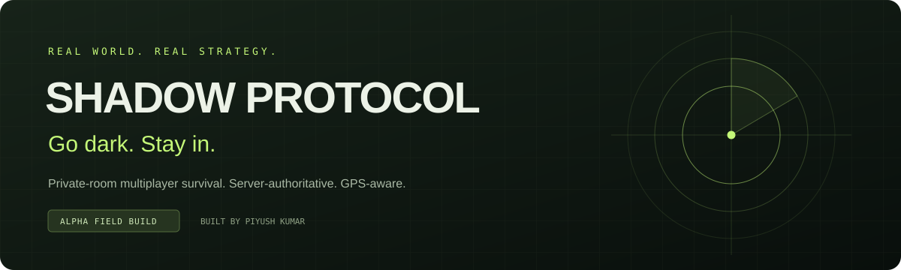

# Shadow Protocol

[](https://github.com/piyush-1803/shadow-protocol/actions/workflows/ci.yml)


[Download release](https://github.com/piyush-1803/shadow-protocol/releases) · [Architecture](docs/ARCHITECTURE.md) · [GPS limitations](docs/GPS.md) · [Contributing](CONTRIBUTING.md)


**Go dark. Stay in.** A real-world, private-room multiplayer survival game built for mobile browsers.

Hunters follow temporary radar signals and request digital tags. Shadows evade until the match clock expires. Host-reviewed shrinking zones add pressure without contact, weapons, or automated unsafe movement instructions.

> **Status: functional engineering field build, not a production-certified release.** Real server persistence and rules are implemented. Thirty-one automated tests pass, and local browser/D1 room creation is verified. Outdoor multi-phone gameplay, battery/network testing, independent security review, and production-scale operations remain unverified. See [limitations](#remaining-limitations) before a field test.

## Stack

| Layer | Implementation |
| --- | --- |
| Interface | React 19, TypeScript, Vite/Vinext, Tailwind CSS, Motion, Zustand |
| Maps | MapLibre GL JS + OpenFreeMap vector tiles; real Leaflet/OSM raster compatibility fallback |
| Geography | Turf geodesic distances, circles, containment and polygon intersection |
| Backend | Cloudflare Worker, same-origin authenticated JSON API |
| Database | Cloudflare D1 / SQLite, generated Drizzle migrations |
| Multiplayer | Server-authoritative state with revision/CAS updates and 2.5-second polling |
| Identity | Secure guest cookies; SHA-256 hashed session tokens |
| Tests | Node test runner; actual SQLite with migrations; isolated synthetic GPS |

The requested Supabase/PostGIS/Realtime architecture was deliberately replaced with the directly supported Workers/D1 runtime so persistent multiplayer does not depend on unavailable Supabase credentials. **This repository does not contain a Supabase backend or PostgreSQL migration.** D1 has no RLS; every read/write is authorized by server code. Vercel is not a drop-in target for this implementation. The current host is private by default: room invitations do not bypass site-level access.

## Implemented

- Private room creation, 8-character invitation code, share link and QR invitation; settings for 2–20 players, 1–4 Hunters, duration, head start, radar/shrink intervals, tag distance and abilities.
- Persistent guest identities, room membership, ready state, presence timestamps and refresh recovery. No fake players or simulated production persistence.
- Real maps, current-location consent, reported accuracy circle, confidence tiers, mild display-only smoothing, raw server GPS validation, stale rejection and movement-jump flags.
- Map-selected or GPS-selected center; 100–1000 m circle; drawn permitted boundary and exclusion polygons. Rejects any arena that intersects an exclusion.
- Server-randomized roles, head start, timed hunt/collapse/final phases, pause/resume, safe host termination and results.
- Fresh-data-only approximate radar circles, expiring after 12 seconds. Exact opponent positions never appear in client snapshots.
- Concentric, gradual zone steps requiring host approval. Next-zone outline for the host. Informational outside-zone exposure; no GPS-outage eliminations.
- Proximity-plausibility checks plus explicit Shadow confirmation for every tag; expiry, cooldown, disputes and host dismissal.
- Ghost mode (30 seconds) and Hunter scan (shared radar pulse), each with a 3-minute cooldown.
- One-tap local GPS stop, server sharing revocation, deletion on stop/leave/end; no route history or analytics.
- High-contrast larger-text toggle, responsive controls, keyboard modal handling, reduced-motion CSS, PWA manifest and network-only service worker.
- Versioned schema, tests, offline development simulation, architecture/GPS/privacy/setup documentation.

## Run locally

```bash
git clone https://github.com/piyush-1803/shadow-protocol.git
cd shadow-protocol
```

Use **Node 24 LTS** and npm. Install from the included lockfile:

```bash
npm ci
npm run build
node --import ./scripts/sites-env.mjs ./node_modules/wrangler/bin/wrangler.js d1 execute DB --local --config dist/server/wrangler.json --persist-to .wrangler/state --file drizzle/0000_violet_puppet_master.sql
npm run dev
```

Open the URL printed by the development server. Localhost is a secure context for browser geolocation; a remote phone requires HTTPS. The local D1 database is under ignored `.wrangler/state`. Apply each new migration once, in order. Don't replay migrations or copy development databases into production.

```bash
npm test
npm run typecheck
npm run simulate
```

The simulation is an **offline, development-only command**, never an app route. It uses synthetic coordinates and no network. Automated fixtures are labeled DEV TEST and isolated from production.

A clean checkout defaults to the portable execution profile. The managed development environment uses its provided preview daemon instead of a second server. The maintained `scripts/` and Vite integration are part of the source and should be retained.

## Deployment

### Existing Sites deployment

The portable `.openai/hosting.json` declares `"d1": "DB"` but intentionally omits the original private Site identity. Register your own Site before using a Sites publishing workflow. The hosting workflow provisions D1 and applies generated migrations before deploying the built Worker. Keep the Site private and grant access only to intended trusted participants. The [existing hosted field build](https://shadow-protocol-piyush.youknowwhat1803.chatgpt.site) is owner-private, not a public playable demo.

Build with `npm run build`. The Worker output is `dist/server`, browser assets `dist/client`. All precise location handling stays server-side. Default map services need no API keys. `.env.example` documents the binding model; it contains no credentials. Never put database/service-role tokens in browser-visible environment variables or Git.

The default hosted workflow does not configure a scheduled trigger, so expiry cleanup there is request-driven. The scheduled cleanup handler is implemented for standalone Cloudflare deployment below.

### Standalone Cloudflare Worker + D1

1. Sign in with `npx wrangler login` on your own machine.
2. Run `npx wrangler d1 create shadow-protocol` and retain the returned database UUID.
3. Run `npm run build`.
4. Run `node scripts/configure-deployment.mjs --database-id YOUR_D1_UUID` using the real UUID. This creates a deployment config beside the built Worker, preserving asset paths and adding a once-per-minute cleanup cron.
5. Apply the schema: `npx wrangler d1 execute shadow-protocol --remote --config dist/server/wrangler.deploy.json --file drizzle/0000_violet_puppet_master.sql`.
6. Review access, provider usage limits and retention. Deploy with `npx wrangler deploy --config dist/server/wrangler.deploy.json`.
7. Test the HTTPS origin with distinct devices/profiles. Inspect the scheduled trigger to confirm cleanup actually runs. Do not assume a successful build proves hosting or GPS behavior.

The standalone deployment instructions and scheduled handler are provided but have **not** been deployed to a separate user-owned Cloudflare account in this session. For future schema changes, append migrations using `npm run db:generate` and apply them in order.

For high traffic, configure your own supported map style/raster provider in `components/ArenaMap.tsx` and `components/RasterMap.tsx`. Respect [OpenFreeMap attribution](https://openfreemap.org/quick_start/) and [OSM standard tile policy](https://operations.osmfoundation.org/policies/tiles/). No bulk/offline tile fetching is implemented. Browser-visible map tokens must be public, origin-restricted provider tokens; secrets remain server-side.

## Play

1. Agree a permitted, accessible outdoor area and stop rules with trusted friends. Minors should be appropriately supervised.
2. Create an operation, review the **entire circle**, draw exclusions and approve only after independent real-world inspection.
3. Share the invitation privately. Each device uses its own guest session; tabs in one browser profile share an identity.
4. Each player explicitly consents to GPS and marks ready inside the arena with a fresh, sufficiently accurate fix.
5. The host starts. Shadows get the head start; Hunters wait. Follow approximate pulses, not precise opponents.
6. Hunters request tags, Shadows confirm only if they can identify the Hunter nearby. Disputes never force elimination.
7. Approve zone steps only with safe walking access. Any active player can pause. Stop sharing or leave whenever necessary.

## Structure

```text
app/                    React interface and authenticated API route
components/             MapLibre and raster map renderers
lib/game/engine.ts      Authoritative rules and privacy-safe serialization
lib/game/geo.ts         Geospatial and GPS validation
lib/game/server.ts      Sessions, authorization, CAS persistence and requests
lib/game/cleanup.ts     Expiry deletion shared by requests and optional cron
lib/game/types.ts       Shared contracts
lib/client.ts           State store and network client
worker/index.ts         Production Worker and optional scheduled cleanup
db/schema.ts            Relational schema
drizzle/                Generated SQL and migration metadata
scripts/                Build/runtime helpers, offline simulator, deployment config
public/                 Icons, manifest, network-only service worker
tests/                 Rule tests and real-SQLite request integration tests
docs/                  Architecture, GPS, privacy, safety and verification
```

## Why this is more than a map with markers

A noisy location sample is not proof of proximity. A countdown on a phone is not an authoritative clock. Hiding a marker in CSS does not protect the coordinates already sent over the network. This implementation addresses those distinctions with uncertainty-aware plausibility checks, explicit tag consent, server deadlines, versioned atomic transitions, and a serializer that never sends other players' raw fixes.

See [Architecture](docs/ARCHITECTURE.md), [GPS and limitations](docs/GPS.md), [Privacy and safety](docs/PRIVACY_SAFETY.md), and [Testing](docs/TESTING.md).

## Remaining limitations

- No outdoor multi-phone validation or independent security/accessibility review. Do not describe this as production-hardened.
- Polling, not WebSockets/Supabase Realtime. Timer events materialize on the next request; there is no background push guarantee.
- Browser GPS is spoofable and unreliable with screen lock. The app stops its watch on hidden pages and requires explicit resumption.
- No automatic road/water/hazard identification, pedestrian routing or route-safety certification. Host attestation is necessary but cannot prove safety. Zones conservatively reject exclusions; they do not navigate around them.
- No autonomous hosted physical-cleanup schedule yet. Expired records are unreadable; request-driven deletion is implemented. Optional standalone cron is implemented but not remotely verified. Provider backups have independent retention.
- Only Ghost and shared Hunter scan abilities. Echo decoys, enhanced directional clues, Zone Insight, Last Stand and short-range QR tag challenges are not implemented. QR is for room invitations only.
- No host transfer, teams, kick/ban workflow, persistent account recovery, long-term match history, analytics, or background notifications.
- No offline gameplay or reliable installability guarantee across all PWA browsers; the manifest/service worker provide a basic foundation only.
- No PostgreSQL/PostGIS schema, Supabase Auth, RLS, Google Maps adapter, or Vercel deployment adapter. These are alternate architectures, not hidden fake integrations.
- Basic request budgets and 20-player caps are not a substitute for adversarial/load testing. The host's match data uses a versioned JSON aggregate rather than one normalized table per event.

No copyrighted game assets are included. Map data © OpenStreetMap contributors; renderer/provider licensing is retained through npm dependencies and on-map attribution.

## Releases and project ownership

Created by [Piyush Kumar](https://github.com/piyush-1803). The project grew from a tactical hide-and-seek idea into an exercise in distributed state, geospatial computation, noisy sensor data and privacy-preserving multiplayer design.

The initial release is **v0.1.0-alpha.1**. Every published alpha ZIP is built from its tagged source commit and accompanied by `SHA256SUMS.txt`. The GitHub workflow checks tests, types and build before publishing. Existing published tags/assets are left unchanged on subsequent runs. See [Changelog](CHANGELOG.md) and [release notes](docs/releases/v0.1.0-alpha.1.md).

A project-wide redistribution license has not been selected. Public source visibility does not imply unrestricted reuse; third-party dependency and vendored-file licenses remain applicable. See [Contributing](CONTRIBUTING.md) and [Security policy](SECURITY.md).
